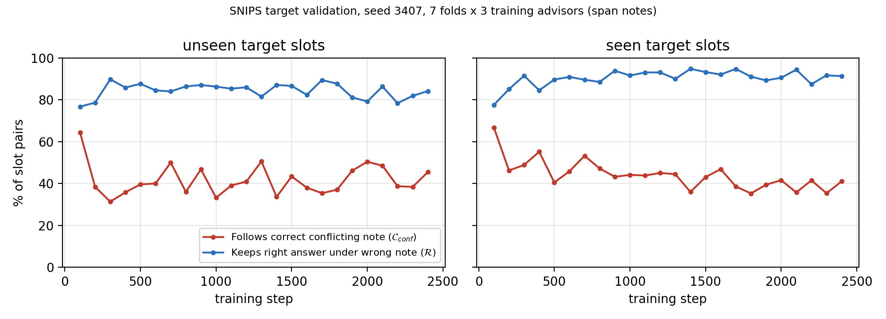
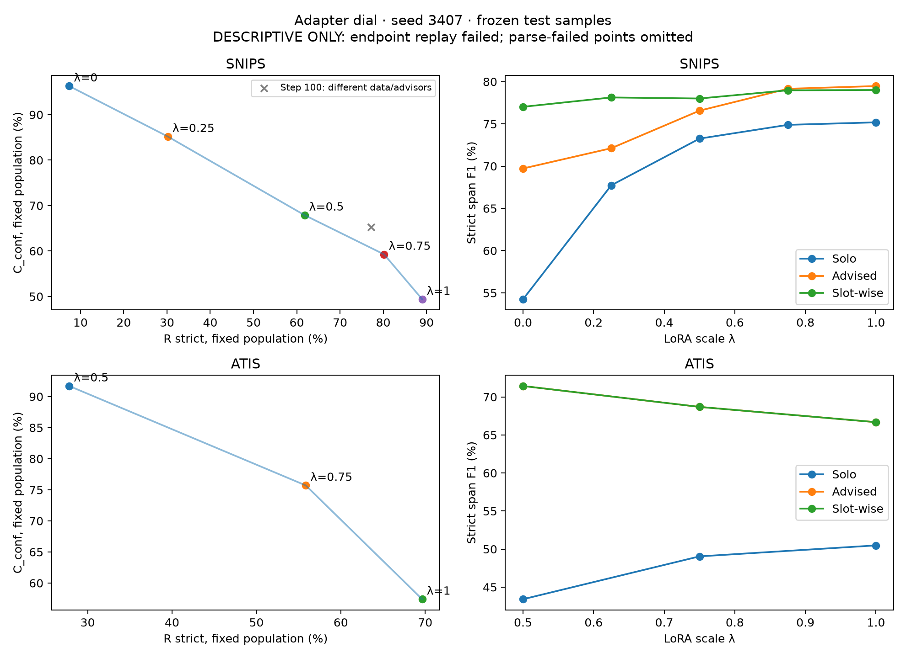

## Abstract

Zero-shot cross-domain slot filling faces a sharp asymmetry between two model classes. Frontier black-box large language models (LLMs) generalize broadly to unseen slots, yet they make frequent boundary errors and cannot be fine-tuned locally. Conversely, compact open-weight models can be fine-tuned to enforce strict span boundaries and output formatting, yet they lack broad coverage on unseen slots. **Advisor-guided slot filling** bridges this gap by pairing a frozen black-box LLM *advisor* with a source-trained open-weight *extractor*. Yet even when the advisor supplies an exact gold span on an unseen slot, the fine-tuned extractor frequently overrides it.

We study why this happens across SNIPS and ATIS and establish three findings. First, source fine-tuning makes the extractor stubborn very early in training, long before it finishes learning to reject noisy advice. This drop happens even on slot names the model already knows, so it is not caused by unfamiliarity with new slots. Second, these overrides are not random mistakes on rare slots. In ATIS, the extractor moves valid advisor spans into more general slots; in SNIPS, it repeatedly rejects a few common words—such as `"my"` for `playlist_owner`—because source training always left those words unlabeled. Third, this split explains what can and cannot be fixed without target labels. A simple slot-name check stops wrong-slot copying on ATIS with zero target labels, whereas no label-free method can tell whether a disputed word like `"my"` is valid under a new dataset's rules. Checking just one to three examples for each recurring disagreement settles those rules cleanly and avoids the heavy side effects of few-shot fine-tuning.

---

## 1. Introduction

Zero-shot cross-domain slot filling extracts target-domain slot values from user utterances without labeled target training data (Liu et al., 2020; Yu et al., 2021). In practice, practitioners face a sharp trade-off between two classes of models. **Frontier black-box large language models (LLMs)** generalize broadly to unseen target slots, yet they cannot be fine-tuned locally and often produce loose span boundaries when prompted directly. Conversely, **compact open-weight LLMs** can be fine-tuned cheaply on source domains to enforce strict span boundaries and output formatting, yet they lack broad coverage on unfamiliar target slots.

**Advisor-guided extraction** combines both strengths through a simple division of labor:

- The **advisor** is a frozen, black-box frontier LLM that reads the utterance and target schema to propose candidate spans for each slot. Because the advisor is never modified, it can be swapped freely across model providers.
- The **extractor** is a compact, open-weight LLM fine-tuned on source-domain data to make the final prediction from the utterance, schema, and advisor notes.

Across cross-domain benchmarks and advisor models, this hybrid setup consistently outperforms running either model alone.

Yet this division of labor creates an unexpected puzzle. Given the same advisor notes, an untuned base model is **controllable but gullible**: it accepts nearly all valid advice, but it also copies most of the advisor's mistakes. Fine-tuning on source domains flips the extractor into a **robust yet stubborn** state. It learns to filter out noisy advice, but it also begins overriding the advisor—even when the advisor supplies the exact gold span on an unseen slot.

This stubbornness shows up in two concrete ways. On SNIPS, the tuned extractor repeatedly drops valid words that clash with source-domain habits. In *"add this track to my global funk"*, for instance, `"my"` is the gold value for `playlist_owner`. Other SNIPS domains leave `"my"` unlabeled, so source training teaches the extractor to ignore it. At test time, the untuned base model accepts the advisor's suggestion `playlist_owner="my"` every time, whereas the source-tuned extractor rejects it every time. On ATIS, a second pattern appears: instead of dropping a valid advisor span, the tuned extractor moves it from a specific role slot (such as `fromloc.city_name`) into a generic slot (such as `city_name`).

Why does source fine-tuning make an extractor override valid advice, and when can we fix it without target labels? To track this shift, Section 2 measures two behaviors (adapting Li et al., 2022; Goyal et al., 2025): **conflict controllability** ($\mathcal{C}_{\mathrm{conf}}$), how often the extractor accepts valid advice when its own prediction is wrong, and **strict noise robustness** ($\mathcal{R}$), how often it keeps a correct prediction when the advice is wrong. Our study answers the question in three steps:

- **Stubbornness sets in early and is not caused by unfamiliar slot names (Section 3).** The extractor's willingness to follow conflicting advice drops within the first 200 training steps, long before noise rejection finishes improving. Scaling down the fine-tuned weights at inference time offers no middle ground where both behaviors stay strong. This drop happens equally on familiar and unfamiliar slots, and explicitly marking unseen slots does not make the extractor defer to the advisor.
- **Overrides concentrate on a few recurring pairs taught by source training (Section 4).** Most conflicts are not random errors on rare slots; they repeat on a small set of slot-and-word pairs. In SNIPS, words like `"my"`, `"this"`, and `"here"` appear hundreds of times in source training with *zero* gold labels, teaching the extractor to reject them on sight. Swapping `"my"` for an ordinary name, or patching in a single late layer from the untuned base model, immediately restores compliance. Fine-tuning thus installs a targeted word-refusal habit rather than breaking the model's ability to use advice.
- **Wrong-slot copying can be fixed without labels, whereas word conventions need a few human confirmations (Sections 5–7).** Because ATIS wrong-slot copying moves spans between slots with the same base name (such as `fromloc.city_name` and `city_name`), a simple rule that routes hijacked spans back to the advisor's slot fixes it without target labels and without hurting SNIPS. By contrast, no label-free method—not even stronger LLM judges—can fix word omissions like `playlist_owner="my"`, because slot names alone do not reveal which words a dataset counts as valid. However, because these disputes repeat on a few pairs, asking an annotator to confirm just one to three examples per pair settles the rule cleanly and avoids the heavy side effects of few-shot fine-tuning.

---

## 2. Experimental Setup

### 2.1 Task, Benchmarks, and Models

#### Task and Slot Partition

An open-weight extractor $E_\theta$ is trained on labeled source domains with slot vocabulary $\mathcal{S}_{\mathrm{src}}$ and evaluated on a held-out target domain with schema $S = (s_1, \dots, s_m)$. Each slot $s_j$ has a canonical name and a brief description. Target slots split into **source-seen slots** ($S_{\mathrm{seen}} = S \cap \mathcal{S}_{\mathrm{src}}$) and **unseen target slots** ($S_{\mathrm{unseen}} = S \setminus \mathcal{S}_{\mathrm{src}}$). Following the function-calling formulation of dialogue state tracking (Li et al., 2024), $E_\theta$ takes an utterance $x$ and schema $S$, and predicts $y = (y_1, \dots, y_m)$, where each $y_j$ is either verbatim substring(s) from $x$ or `NONE`.

#### Benchmarks

We evaluate on two English benchmarks summarized in Table 2:

- **SNIPS** (Coucke et al., 2018): A 7-fold leave-one-domain-out benchmark covering 39 unique slots, with 10,984 test utterances and 500 validation utterances per fold. Source-seen slots are non-empty in all 7 folds, while unseen slots appear in 6 of 7 folds (all except `SearchCreativeWork`).
- **SNIPS-to-ATIS** (Hemphill et al., 1990): Extractors trained on SNIPS are tested zero-shot on the 83-slot ATIS flight-booking schema (5,371 test utterances with 17,720 gold entities, plus 500 validation utterances). ATIS shares 0 of 83 exact slot names with SNIPS, placing every slot in $S_{\mathrm{unseen}}$ and introducing dot-qualified role hierarchies such as `fromloc.city_name`, `toloc.city_name`, and `city_name`.

#### Frozen Advisors and Source-Tuned Extractor

At inference time, a frozen black-box LLM *advisor* reads the utterance and schema and returns a JSON array of slot-level notes $\{(\tau_j, c_j)\}_{j=1}^m$. Each note pairs a stance tag $\tau_j \in \{\texttt{keep}, \texttt{maybe}, \texttt{drop}\}$ with an optional contiguous substring $c_j$ from $x$ (which is null whenever $\tau_j = \texttt{drop}$). We omit free-text rationales so the note format stays uniform across all four frozen advisors: `DeepSeek-V4-Flash`, `DeepSeek-V3.2`, `Qwen3-27B`, and `Luna xhigh`. To test the extractor without advice (`Solo` mode) under the exact same prompt framing, we pass neutral placeholders $\{(\texttt{maybe}, \mathrm{null})\}_{j=1}^m$.

Unless noted otherwise, the extractor $E_\theta$ is `Qwen3-8B` (Yang et al., 2025) fine-tuned on source-domain utterances paired with advisor notes and neutral placeholders using QLoRA/LoRA ($r=16$) (Hu et al., 2022; Dettmers et al., 2023) across three random seeds (3407, 4101, 5203).

### 2.2 Separating Controllability from Noise Robustness

Let $\hat{y}^{\mathrm{solo}}$ denote the extractor's solo prediction and $\hat{y}$ its prediction when given advisor notes. For any slot $s_j$ with a non-neutral advisor note, we call the note *correct* if $c_j = y_j$ (or $\tau_j = \texttt{drop}$ when $y_j = \texttt{NONE}$), and *wrong* otherwise. This divides all non-neutral predictions into the four cases in Table 1.

| | **Note correct** | **Note wrong** |
| :--- | :--- | :--- |
| **Solo correct** | Redundant agreement | Harmful disagreement ($\mathcal{R}$) |
| **Solo wrong** | Note-critical ($\mathcal{C}_{\mathrm{conf}}$) | Both wrong |

*Table 1: Four-cell breakdown of advisor–extractor interaction on a single slot. Conflict controllability ($\mathcal{C}_{\mathrm{conf}}$) isolates the note-critical cell; strict noise robustness ($\mathcal{R}$) isolates the harmful-disagreement cell.*

Adapting Li et al. (2022), we measure the two off-diagonal behaviors:

$$
\mathcal{C}_{\mathrm{conf}} = \Pr\bigl(\hat{y}_j = y_j \;\big|\; \hat{y}^{\mathrm{solo}}_j \neq y_j,\; \mathrm{note}_j \text{ is correct}\bigr) \tag{1}
$$

$$
\mathcal{R} = \Pr\bigl(\hat{y}_j = y_j \;\big|\; \hat{y}^{\mathrm{solo}}_j = y_j,\; \mathrm{note}_j \text{ is wrong}\bigr) \tag{2}
$$

Two measurement choices keep stubbornness visible:

1. **Isolating true conflicts from easy agreements.** Averaging over all correct notes mixes genuine conflicts with easy cases where the extractor already agrees with the advisor. On a 700-utterance SNIPS sample (`DeepSeek-V4-Flash`, seed 3407), 86.6% of all correct notes survive in the final output, which hides the fact that the extractor follows conflicting notes only 48.36% of the time on SNIPS validation.
2. **Enforcing strict span robustness.** Equation (2) requires the extractor to keep the exact gold value $y_j$, not merely reject a bad suggestion. In our training-checkpoint and weight-scaling analyses, we compute $\mathcal{C}_{\mathrm{conf}}$ and $\mathcal{R}$ over notes proposing non-null spans and evaluate explicit `drop` notes separately, preventing empty rejections from inflating robustness.

### 2.3 Evaluation Protocols and Zero-Label Boundaries

| Study Component | Scope & Size | Target Labels Used? | Evidence Role |
| :--- | :--- | :--- | :--- |
| SNIPS main & uncertainty routing | 7 folds, 39 slots (10,984 test; 700-utt sample) | None at inference / routing | Descriptive |
| ATIS test & error flow | 83 slots (5,371 test, 17,720 gold; 1,000-utt sample) | None at inference / gating | Post hoc (3407 gate) / Descriptive |
| ATIS clean gate validation | 500 untouched ATIS val utts, V4-Flash, 3 seeds | None (eval-only gold) | **Pre-registered rule** (PASS 3/3) |
| Trajectory & weight-scaling diagnostics | SNIPS 500 val/fold; SNIPS 700 / ATIS 1,000 / ATP 500 | Eval-only (diagnostic) | Descriptive / Post hoc |
| Zero-label cluster verification | SNIPS 500 val → 10,984 test; ATIS 2,685 / 2,686 split | None (zero target labels) | **Pre-registered rule** (all 6 fail) |
| Cluster-level binary verification | Same SNIPS (23 span) & ATIS (8/13/8) cluster splits | 1–3 yes/no val labels / cluster | **Pre-registered rule** (secondary) |
| Few-shot fine-tuning comparison | SNIPS seed 3407 (80 target utts, 605 slot / 238 spans) | 80 fully labeled utterances | **Pre-registered rule** / Post hoc lock |

*Table 2: Summary of benchmarks, splits, target-label access, and evidence classifications across the study. "ATP" denotes the 500-utterance `AddToPlaylist` validation split.*

Because mixing target supervision into zero-shot claims obscures what unlabeled adaptation can achieve, we separate three experimental regimes:

- **Strict zero-label main line (Sections 3–5).** Target-domain inputs consist strictly of slot schemas and unlabeled utterances. Recurring $(\mathrm{slot}, \mathrm{span})$ conflict clusters are discovered solely from disagreements between `Solo` and advisor outputs on unlabeled text: on SNIPS validation (500 utterances/fold), we keep span clusters with $\ge 15$ pairs and slot clusters with $\ge 30$ pairs; on ATIS, we split the 5,371 test utterances 50/50 into 2,685 discovery utterances (keeping clusters with $\ge 81$ pairs) and 2,686 disjoint evaluation utterances. No target gold labels touch cluster discovery, zero-label verification, or structural gating.
- **Checkpoint-selection transparency.** Source-trained adapters select early-stopping checkpoints on target validation utterances (steps 1600–2500 on SNIPS; 2200–2700 on ATIS). The checkpoint sweep in Section 3 evaluates steps 100–2600 strictly as a descriptive training-dynamics diagnostic. By contrast, our clean ATIS validation check in Section 5 evaluates freshly generated zero-shot notes on 500 untouched ATIS validation utterances using fixed gate logic locked prior to execution.
- **Secondary verification and few-shot regimes (Sections 6–7).** Target gold labels enter *only* in Section 6 (1–3 binary `yes`/`no` answers per discovered span cluster) to test whether convention ambiguity explains the zero-label ceiling, and in Section 7 (80 fully labeled utterances) to compare annotation cost and collateral harm against few-shot fine-tuning.

To keep exploratory findings distinct from confirmatory tests, Table 2 tags each experiment as a **pre-registered rule** (criteria fixed before inspection), **post hoc** (formulated after inspecting intermediate outputs), or **descriptive** (diagnostic audit without a pass/fail gate).

---

## 3. The Controllability–Robustness Trade-Off

Why does a source-trained extractor override valid target-domain advice? In this section, we first contrast the untuned base model against the source-tuned extractor on identical advisor notes. We then test three intuitive explanations for stubbornness: late training overfitting, overly strong fine-tuning weights at inference time, and unfamiliarity with unseen slot names. Throughout, we distinguish between results evaluated under a *pre-registered rule*, *post-hoc* analyses, and *descriptive* measurements.

### 3.1 Base Model vs. Source-Tuned Extractor

| Dataset (Sample) | Model | Parse Fail | Strict F1 | Correct Kept | Wrong Removed | Wrong-Slot Copies / New FP |
| :--- | :--- | ---: | ---: | ---: | ---: | ---: |
| SNIPS (700 utts) | Base `B0` (Null) | 0.0% | 54.46 | — | — | — |
| | Base `B1` (+V4-Flash) | 0.0% | 69.65 | 98.6% (1,298/1,316) | 7.5% (49/654) | 10 / 18 (55.6%) |
| | `AASF-null` | 0.0% | 75.05 | — | — | — |
| | `AASF` (+V4-Flash) | 0.0% | 79.39 | 86.6% (1,140/1,316) | 80.4% (526/654) | 22 / 80 (27.5%) |
| ATIS (1,000 utts) | Base `B0` (Null) | 5.5% | 12.63 | — | — | — |
| | Base `B1` (+V4-Flash) | 0.3% | 79.54 | 97.5% (2,859/2,931) | 24.6% (324/1,316) | 3 / 26 (11.5%) |
| | `AASF` (+V4-Flash, 3-seed) | 0.0% | 64.90 | 79.4% (76.2%–82.3%) | 60.6% (58.0%–65.0%) | 88.2%–92.6% (953–1,119 / 1,080–1,208) |

*Table 3: Untuned `Qwen3-8B` (`B0`/`B1`) vs. source-tuned `AASF` on frozen `DeepSeek-V4-Flash` notes (descriptive comparison). Base `B0` on ATIS exceeds the 5% parse-failure gate (55/1,000). Source fine-tuning flips the extractor from gullible (`B1`) to robust yet selectively stubborn, producing convention omission on SNIPS and schema-bias slot reassignment on ATIS.*

Table 3 compares untuned `Qwen3-8B` against the source-tuned extractor on diagnostic samples from SNIPS (700 utterances) and ATIS (1,000 utterances) using identical `DeepSeek-V4-Flash` notes. The untuned base model is **controllable but gullible**. It preserves 98.6% of correct notes on SNIPS and 97.5% on ATIS, yet removes only 7.5% of wrong notes on SNIPS and 24.6% on ATIS. On ATIS, it introduces just 26 new false positives (3 wrong-slot copies), though without advisor notes it fails to parse 5.5% of outputs and drops to 12.63 F1.

Source fine-tuning eliminates parse errors and flips the extractor into a **robust yet stubborn** regime. On SNIPS, it raises F1 from 75.05 (`Solo`) to 79.39 and rejects 80.4% of wrong notes, while correct-note retention dips to 86.6%. On ATIS, where every target slot is unseen, the tuned extractor still removes 60.6% of wrong notes across three seeds, yet strict F1 drops sharply to 64.90—well below the untuned model's 79.54.

Closer inspection reveals that this stubbornness takes two distinct forms across benchmarks:

1. **Clustered convention omission (SNIPS):** When target conventions clash with source training, the tuned extractor suppresses valid advisor spans to `NONE`. Across all 32 occurrences of `playlist_owner="my"` in the SNIPS sample, the untuned base model accepts 32/32 (100%), whereas the source-tuned extractor accepts 0/32 (0%).
2. **Schema-bias slot reassignment (ATIS):** Rather than dropping unfamiliar spans, the tuned extractor redirects them. On the ATIS sample, 88.2%–92.6% of new false positives per seed copy a valid advisor span from a specific role-qualified slot into a generic slot (such as moving `fromloc.city_name` into `city_name`). On the full 5,371-utterance ATIS test set, where raw `V4-Flash` notes reach 77.60 F1, the tuned extractor drops to 62.18–66.92 F1 across seeds, with 91.6% of lost entities reappearing under another slot (16,333/17,823 pooled).

### 3.2 Early Collapse During Fine-Tuning (Not Late Overfitting)

*Figure 1: Training-checkpoint trajectory on SNIPS target validation (seed 3407, 7 folds × 3 training advisors, span notes; descriptive). Between steps 100 and 200, conflict controllability $\mathcal{C}_{\mathrm{conf}}$ collapses in parallel on both unseen (64.50% → 38.43%) and seen (66.82% → 46.24%) target slots, while strict noise robustness $\mathcal{R}$ climbs toward its plateau.*

Could stubbornness simply be late overfitting that early stopping would avoid? Figure 1 tracks conflict controllability ($\mathcal{C}_{\mathrm{conf}}$) and strict noise robustness ($\mathcal{R}$) from step 100 to step 2600 on SNIPS validation (seed 3407, 7 folds × 3 training advisors; descriptive). Between steps 100 and 200, $\mathcal{C}_{\mathrm{conf}}$ collapses from **65.27%** to **41.02%** and stays flat thereafter, averaging 41.52% over steps 200–2400 (48.36% at validation-selected checkpoints). Over the same window, strict $\mathcal{R}$ rises from **77.18%** to **82.33%** at step 200 and plateaus at a mean of **88.44%** (86.68% at selected checkpoints).

Three controls confirm this early drop is not a measurement artifact. First, total conflict cases decline by only 16% after step 100 while followed conflicts drop by 46%. Evaluating a **fixed population** of slot pairs that remain conflicts at every checkpoint reproduces the same collapse (60.17% → 48.44% at step 200). Second, the drop is symmetric across slot familiarity: between steps 100 and 200, seen slots fall from **66.82%** to **46.24%** and unseen slots fall from **64.50%** to **38.43%**. Because every training example belongs to a seen slot, this parallel drop points to a general habit of trusting internal predictions over external notes, consistent with context-parametric inversion (Goyal et al., 2025). Third, on `AddToPlaylist`, where `playlist_owner="my"` clashes with source priors, $\mathcal{C}_{\mathrm{conf}}$ plunges from 28.20% at step 100 to 13.78% at step 200 and 8.05% at selected step 1800.

### 3.3 Weight Scaling Reveals No Middle Ground

*Figure 2: Linearly scaling the LoRA adapter weight $\lambda \in \{0.0, 0.25, 0.5, 0.75, 1.0\}$ on SNIPS (700 utts) and ATIS (1,000 utts), seed 3407 (descriptive reference curve). Stubbornness turns on sharply between $\lambda=0.25$ and $\lambda=0.5$ before wrong-note rejection $\mathcal{R}$ matures.*

If stubbornness begins early, can scaling down the LoRA adapter weight $\lambda \in \{0.0, 0.25, 0.5, 0.75, 1.0\}$ at inference time find a middle ground?[^1] Across both datasets, Figure 2 shows that stubbornness switches on sharply between $\lambda=0.25$ and $\lambda=0.5$, *before* noise rejection matures:

- **SNIPS (700 utts):** Fixed-span $\mathcal{C}_{\mathrm{conf}}$ falls monotonically from 96.30% ($\lambda=0.0$) to 49.38% ($\lambda=1.0$), while strict $\mathcal{R}$ climbs from 7.40% to 89.00%. Compliance on `playlist_owner="my"` collapses from 32/32 ($\lambda=0.0$) and 26/32 ($\lambda=0.25$) to **1/32** ($\lambda=0.5$) and 0/32 ($\lambda \ge 0.75$), even though $\mathcal{R}$ at $\lambda=0.5$ still lags $\lambda=1.0$ by 27.2 points (61.80% vs. 89.00%). Meanwhile, advised F1 rises steadily from 69.72 to 79.48, leaving no $\lambda$ that restores controllability without hurting SNIPS F1.
- **Matched `AddToPlaylist` validation (500 utts):** The exact same cliff recurs. Unseen $\mathcal{C}_{\mathrm{conf}}$ drops from 92.82% and 57.95% ($\lambda \le 0.25$) to 6.15%–9.23% ($\lambda \ge 0.5$), and `"my"` compliance collapses from 119/119 and 99/119 to **1/119** at $\lambda=0.5$ (0/119 beyond), while seen-slot $\mathcal{R}$ is still climbing from 0.25% to 84.71%.
- **ATIS (1,000 utts):** Wrong-slot copies jump from 3 ($\lambda=0.0$) and 69 ($\lambda=0.25$) to **740** ($\lambda=0.5$) and 1,008 ($\lambda=0.75$). Advised F1 drops accordingly from 79.46–80.22 down to 71.44 ($\lambda=0.5$) and 66.68 ($\lambda=1.0$). Because the high-F1 base endpoints fail the 5% `Solo` parse-failure gate (5.6% and 11.7%), no $\lambda$ repairs ATIS above raw notes while passing the parse gate and preserving SNIPS F1.

### 3.4 Unfamiliar Slot Names Are Not the Cause

Another natural hypothesis is that the extractor handles unfamiliar slot names poorly and would defer to the advisor if explicitly told which slots are unseen. We tested this directly in a controlled holdout experiment: we held out 10 source-seen slots as simulated unseen targets and compared a standard source-trained model against one trained with an explicit unseen-slot familiarity tag. For a familiarity tag to signal genuine model weakness, the pre-registered protocol required `Solo` accuracy on the held-out slots to stay below 60%.

That precondition **failed immediately**. `Solo` accuracy on the held-out slots reached **95.34%** in the untagged control and **94.32%** in the tagged model, already hitting 87.4% by step 50. Even in an early 600-step diagnostic window, the familiarity tag improved unseen conflict controllability by only +2.05 percentage points (95% CI $[-1.31, +5.74]$ vs. the $+10.0$ pp target), and left `"my"` compliance at 2.5% compared to 14.1% in control. Stubbornness is therefore *not* caused by an inability to handle unseen slot names; it arises when source-trained priors actively contradict target annotation conventions.

---

## 4. Conflicts Are Dataset Conventions in Clusters

If target stubbornness is not a general weakness on unseen slots, what causes the extractor to override valid advisor notes? We show that advisor–extractor conflicts are **dataset-level annotation conventions** concentrated in a small number of recurring `(slot, span)` clusters, where source-domain supervision actively teaches the opposite label, checkpoints oscillate rather than forgetting monotonically, and blanket zero-label overrides fail because valid conventions coexist with recurring advisor errors.

### 4.1 Cluster Concentration of Conflicts

Cross-domain slot filling frequently disagrees on boundary policies that have no single-utterance semantic answer: whether possessive `"my"` fills `playlist_owner`, whether deictic `"this"` fills `object_select`, whether `"here"` fills `current_location`, or whether generic words like `"flight"` and `"after"` fill ATIS slots. Grouping disagreements between `Solo` and the advisor by `(slot, span)` and `(slot)` under our pre-set discovery protocol reveals extreme concentration:

- **SNIPS:** On SNIPS validation (seed 3407 discovery, `V4-Flash`), **52** recurring clusters—23 `(slot, span)` span clusters ($\ge 15$ pairs, covering 1,088 pairs) and 29 `(slot)` clusters ($\ge 30$ pairs)—account for **3,068 of 4,585** total conflict pairs across the 7 folds. The same concentration holds for `DeepSeek-V3.2` (51 clusters, including 24 span clusters covering 1,011 pairs, total 2,940/4,720) and `Qwen3-27B` (34 clusters, including 12 span clusters covering 668 pairs).
- **ATIS:** On the 2,685-utterance discovery half ($\text{min\_size} = 81$), only **8–13** span clusters per seed (8, 13, and 8; mean **9.67**) cover 1,940, 2,633, and 2,061 pairs (mean 2,211.3). Five convention-word clusters appearing across all three seeds—(`depart_time.time_relative`, `"after"`), (`flight`, `"flight"`), (`flight`, `"flights"`), (`transport_type`, `"flight"`), and (`transport_type`, `"flights"`)—account for **69%** of the recoverable oracle F1 gain ($+1.95$ of $+2.81$ F1; 527 fixed vs. 0.67 harmed, compared to $-2.97$ F1 for `V-always`).

### 4.2 Source Training Actively Contradicts Target Conventions

| Target Slot | Span | Source Occ. (Gold) | Target Val Gold |
| :--- | :--- | ---: | ---: |
| `playlist_owner` | `"my"` | 375 (0 gold) | 99.2% (119/120) |
| `object_select` | `"this"` | 624 (0 gold) | 97.2% (106/109) |
| `current_location` | `"here"` | 65 (0 gold) | 95.2% (20/21) |

*Table 4: Stage 1a source-training lookup ($L$) vs. target validation oracle share on SNIPS `V4-Flash` (pre-set rule). The extractor saw these exact words hundreds of times in source training with zero gold slot labels, installing a strong `reject` prior that directly contradicts target conventions.*

Querying the 6 SNIPS source-training domains per fold for exact target spans (Stage 1a source lookup $L$, pre-set rule) shows that the extractor is not merely undertrained on target convention words—it saw them hundreds of times labeled **negative** (Table 4). Specifically, `"my"` appears **375 times** (372 utterances) in source training with **0** gold slot labels, so $L$ predicts `reject`, directly contradicting `AddToPlaylist` target validation gold where `"my"` is gold **99.2%** of the time (119/120). Likewise, `"this"` appears **624 times** (604 utterances) with **0** gold labels vs. **97.2%** (106/109) gold for `RateBook` `object_select`, and `"here"` appears **65 times** (65 utterances) with **0** gold labels vs. **95.2%** (20/21) gold for `GetWeather` `current_location`.

### 4.3 Checkpoint Oscillation Before Stubborn Convergence

Tracking `AddToPlaylist` checkpoints on the 119 validation utterances where `V4-Flash` outputs `keep:"my"` (descriptive) shows that the extractor does not forget `"my"` monotonically; instead, the cluster switches on and off unstably before settling into stubbornness. At step 100, `Solo` predicts `"my"` on 84/119 utterances (`Adv`: 27/119). Across steps 200–600, `Adv` stays at 0/119 and `Solo` stays at 0–1/119 (1/119 at step 300), before rebounding at step 700 (59/119 `Solo`, 56/119 `Adv`), dropping to 0/119 at step 800, rebounding again at step 900 (32/119 `Solo`, 69/119 `Adv`), and falling through step 1000 (1/119, 0/119) and step 1100 (9/119, 10/119). From steps 1200–2500, `Adv` remains at 0/119 and `Solo` at 0–2/119 (1/119 at steps 1200 and 2400; 2/119 at step 2100; 0/119 for both at selected step 1800, where overall $\mathcal{C}_{\mathrm{new}} = 18/195 = 9.2\%$), with 2/119 for both at step 2600.

### 4.4 Why Blanket Overrides Hurt Overall

| Benchmark (Scope) | Rule | $\Delta$F1 | Fixed : Harmed | Acc. |
| :--- | :--- | ---: | ---: | ---: |
| SNIPS (all 52 clusters) | `V-always` | $-2.77$ | 1,996.7 : 4,939.7 | 27.2% |
| | `V-tag` | $-2.43$ | 1,942.3 : 4,580.0 | 31.6% |
| SNIPS (23 span only) | `V-always` | $+0.74$ | 1,129.0 : 1,050.7 | — |
| ATIS (29 clusters / 3 seeds) | `V-always` | $-2.14$ | 166.7 : 1,042.0 | 28.8% |

*Table 5: Blanket zero-label overrides across clusters (`V4-Flash`). All-52 SNIPS and ATIS results follow pre-set rules; the SNIPS 23-span-only view is post-hoc from Stage 0. Because genuine conventions coexist with recurring advisor errors, following all conflicting notes degrades overall F1.*

Because genuine target conventions (e.g., `"my"`, `"this"`, `"here"`) coexist in clusters alongside recurring advisor mistakes (e.g., `"weather"` for `condition_description`, `"restaurant"` for `restaurant_type`, or spurious ATIS spans), blindly forcing the extractor to follow conflicting notes is harmful overall (Table 5). Across all 52 SNIPS clusters (pre-set rule), `V-always` lowers F1 by $-2.77$ (to 76.92; 1,996.7 fixed vs. 4,939.7 harmed; 27.2% cluster accuracy; $-3.45$ on `V3.2`), and `V-tag` lowers F1 by $-2.43$ (77.26; 1,942.3 fixed vs. 4,580 harmed; 31.6% accuracy). On ATIS, `V-always` drops F1 by $-2.14$ (63.06; 166.7 fixed vs. 1,042 harmed; 28.8% accuracy). Even when restricted post hoc to the 23 SNIPS span clusters, where `V-always` yields a small net gain ($+0.74$ F1), it breaks 1,050.7 slots to fix 1,129 (1.07:1) and severely damages `GetWeather` ($-4.31$ F1).

### 4.5 Causal Link to Mechanistic Probing

Mechanistic probing of `Qwen3-8B` on the `playlist_owner="my"` conflict ($A_{\text{my}}$) confirms that this refusal is a localized, source-induced lexical suppression rather than an inability to copy spans. Under actual prompts ($n=707$, pre-set rule), untuned `Qwen3-8B` (`base:actual`) assigns `"my"` as the top-1 next-token candidate in 99.72%–99.86% of cases, whereas `AASF` (`aasf:actual`) drops to **0.0%** (0.14% on legacy seed 3407). Replacing `"my"` with an unfamiliar name (`"my"` $\to$ `"daphne s"`, $n=696$, pre-set rule) immediately raises `AASF`'s next-token candidate top-1 rate to 72.84%, 56.32%, and 96.12% across seeds (direct-notes; 98.99%, 81.75%, and 38.79% on legacy). Finally, patching layer-34 residual activations from the base model into `AASF` at the target slot token ($n=273$ per seed, clean rate 0.0%; descriptive, outside pre-registration) restores next-token candidate `"my"` top-1 rates to **95.24%–97.07%** on direct-notes adapters (95.24%, 97.07%, 95.97%) and **96.34%–98.53%** on legacy adapters (98.53%, 96.34%, 97.44%; reaching 98.90%–100.0% at layer 35 and 100.0% at layer 36).

---

## 5. What Zero-Label Methods Recover

Having established that advisor–extractor conflicts stem from clustered annotation conventions rather than isolated utterance noise, we evaluate what can be recovered strictly without target-domain labels. Across three zero-label families—inference-time uncertainty routing, structural output de-biasing, and label-free cluster heuristics—we find a sharp boundary: structural constraints on schema slot names reliably repair cross-slot hijacking on hierarchical schemas, whereas neither uncertainty routing nor uniform cluster rules can break dataset-specific convention conflicts.

### 5.1 Inference-Time Uncertainty Routing

Selective routing asks whether querying the advisor only on uncertain slots can cut inference cost without sacrificing accuracy. On the 700-utterance SNIPS routing benchmark (`DeepSeek-V4-Flash`, seed 3407, without seen-slot locking; *Descriptive*), prompted self-report ("do you need help?") fails: pre-answer self-report achieves an AUROC of only 0.4376, asking *less* often when the extractor is wrong (28.1% vs. 37.8% when right, a $-9.63$ pp gap), and post-answer self-report reaches 0.472. By contrast, output token confidence provides a useful ranking signal, achieving an AUROC of 0.744 overall (0.717 on `NONE` predictions).

| Routing Policy (Budget) | F1 | Fixed | Broken |
| :--- | ---: | ---: | ---: |
| Null (`Solo`, 0%) | 75.05 | 0 | 0 |
| Full advice (100%) | 79.39 | 214 | 87 |
| Oracle (10%, 530 asked) | 79.44 | 136 | 0 |
| Oracle (25%) | 80.00 | 195 | 11 |
| Token confidence (10%) | 76.27 | 67 | 30 |
| Token confidence (25%) | 77.34 | — | — |
| Token confidence (50%) | 77.40 | — | — |
| Unseen-first (50%) | 78.24 | 138 | 33 |

*Table 6: Inference-time routing on the 700-utterance SNIPS benchmark (`DeepSeek-V4-Flash`, seed 3407, Descriptive). Oracle routing at 10%–25% matches or exceeds full advice, and token confidence outperforms prompted self-report (AUROC 0.744 vs. 0.4376), but routing never resolves convention conflicts.*

As summarized in Table 6, oracle routing at a 25% query budget reaches 80.00 F1 (195 fixed / 11 broken), outperforming 100% full notes (79.39 F1, 214 fixed / 87 broken), and even 10% oracle routing (530 asked slots) matches full advice (79.44 F1, 136 fixed / 0 broken). Token-confidence routing recovers 76.27 F1 at 10% (67 fixed / 30 broken) and 77.34 at 25% before plateauing at 50% (77.40), while unseen-first routing at 50% reaches 78.24 F1 (138 fixed / 33 broken).

However, routing is purely an efficiency mechanism and cannot resolve convention conflicts. In an audit of the 394 unfixed slots out of 530 queried under 10% oracle routing (*Descriptive*), 167 carry exact-gold advisor notes that the extractor still overrides (146 candidate spans and 21 explicit `drop` notes), alongside 227 advisor failures (113 wrong drops, 112 wrong spans, and 2 empty/neutral notes). Consequently, unseen F1 on `AddToPlaylist` remains near zero (1.45–4.30) regardless of routing budget.

### 5.2 Zero-Label Structural De-Biasing: Same-Family Span-Binding Gate

On hierarchical schemas such as ATIS, where source-trained extractors exhibit schema-bias slot reassignment (Section 3), a deterministic structural output gate can repair hijacked spans using only schema slot names and current advisor notes—requiring neither target labels nor retraining.

#### Mechanism

Define the slot-family head $h(s)$ as the final dot-delimited segment of a slot name $s$ (e.g., $h(\texttt{fromloc.city\_name}) = h(\texttt{city\_name}) = \texttt{city\_name}$). Whenever the extractor outputs a non-empty value $v$ on slot $s_k$ for which the advisor proposed no candidate span ($c_k = \mathrm{null}$), while the advisor proposed $c_j = v$ on a distinct same-family slot $s_j$ ($h(s_j) = h(s_k)$) that the extractor left `NONE`, the **Same-Family Span-Binding Gate** blocks the hijacked prediction on $s_k$ and rebinds $v$ to $s_j$. Note that when $S_{\mathrm{seen}} = \varnothing$ (as on ATIS), a seen-slot gate cannot fire, making structural rebinding the primary zero-label lever.

#### Why Family Restriction Is Mandatory

Although the gate was originally formulated *post hoc* from ATIS test error flow (seed 3407, 5,371 utterances, `DeepSeek-V4-Flash`), restricting rebinding to same-head families is essential for cross-domain safety. As shown in Table 7, unconstrained cross-family variants push ATIS seed 3407 even higher—from 66.91 baseline ($\mathrm{TP}=13{,}371$, $\mathrm{FP}=8{,}879$, $\mathrm{FN}=4{,}349$) to 81.10 for Full Bind ($\mathrm{TP}=15{,}023$, $\mathrm{FP}=4{,}303$), 81.09 for Role-Family Bind, and 81.94 for Family+Drop (vs. 75.79 for Block hijack alone, $\mathrm{FP}=4{,}002$, and 75.70 for Drop gate)—but they do so only by overfitting ATIS's zero-seen-slot topology. On SNIPS (10,984 utterances × 3 seeds × 3 advisors, `Qwen3-27B` seed 5203 omitted; *Descriptive* transfer check), Full Bind *lowers* F1 for every advisor: `V4-Flash` drops $79.69 \to 78.47$, `V3.2` drops $78.60 \to 76.64$, and `Qwen3-27B` drops $79.68 \to 77.53$, while Family+Drop drops further to 77.19 / 75.72 / 75.93. By contrast, Same-Family Span-Binding preserves a $+11.55$ F1 gain on ATIS seed 3407 ($66.91 \to 78.46$; $\mathrm{P}=74.91$, $\mathrm{R}=82.35$, $\mathrm{TP}=14{,}593$, $\mathrm{FP}=4{,}887$, $\mathrm{FN}=3{,}127$; 2,938 utterances changed), surpassing raw advisor notes (77.60), while guaranteeing an exact 0.00 side effect on flat schemas such as SNIPS (79.69 / 78.60 / 79.68).

| Gate Variant | ATIS (3407) | SNIPS V4 | SNIPS V3.2 | SNIPS Qwen |
| :--- | ---: | ---: | ---: | ---: |
| Base (ungated) | 66.91 | 79.69 | 78.60 | 79.68 |
| Raw advisor notes | 77.60 | — | — | — |
| Block hijack only | 75.79 | — | — | — |
| Drop gate | 75.70 | — | — | — |
| Full Bind | 81.10 | 78.47 | 76.64 | 77.53 |
| Role-Family Bind | 81.09 | — | — | — |
| Family + Drop | 81.94 | 77.19 | 75.72 | 75.93 |
| **Same-Family Bind** | **78.46** | **79.69** | **78.60** | **79.68** |

*Table 7: Ablation of Span-Binding Gate variants on ATIS full test (seed 3407, 5,371 utts, Post hoc) and SNIPS transfer check (10,984 utts × 3 seeds × 3 advisors, Descriptive). Only Same-Family Bind preserves ATIS gains above raw notes while guaranteeing 0.00 side effect on SNIPS.*

#### Independent Reproduction and Clean Out-of-Sample Validation

On the independent 2,686-utterance ATIS evaluation half (`Option B1`, `V4-Flash`, *Pre-set rule* baseline), Same-Family Span-Binding reproduces a $+13.03$ F1 gain across all 3 seeds ($65.20 \to 78.23$ mean; seed 3407: $66.72 \to 77.89$, seed 4101: $61.75 \to 78.67$, seed 5203: $67.13 \to 78.14$).

More importantly, in a clean out-of-sample validation on 500 untouched ATIS validation utterances with freshly generated zero-shot `DeepSeek-V4-Flash` notes (*Pre-set rule*), the unchanged Same-Family Span-Binding Gate passes the pre-set $\ge +5.0$ F1 threshold in **3/3 seeds**:

- Seed 3407: $68.36 \to 78.30$ (**$+9.94$** F1, 95% CI $[8.80, 11.14]$, 253/500 utterances changed);
- Seed 4101: $62.23 \to 77.12$ (**$+14.89$** F1, 95% CI $[13.28, 16.55]$, 320/500 changed);
- Seed 5203: $66.89 \to 77.81$ (**$+10.92$** F1, 95% CI $[9.81, 12.11]$, 297/500 changed).

Across the three seeds, mean F1 rises from 65.83 to 77.74 (**$+11.92$** F1; paired `Solo` mean 47.19), again exceeding raw advisor notes (75.85). Extending to 18 additional secondary ATIS runs (*Descriptive*; validation with `Luna xhigh` and full test with `V4-Flash` and `Qwen3-27B` across `advisor_aware` and `direct_notes`), Same-Family Span-Binding improves **21/21 ATIS runs total** by $+9.43$ to $+21.72$ F1: validation `Luna xhigh` gains $+12.90$ ($66.49 \to 79.39$, `advisor_aware`) and $+11.30$ ($65.45 \to 76.75$, `direct_notes`), while test runs gain $+13.51$ ($65.34 \to 78.84$, `advisor_aware+V4`), $+15.30$ ($58.84 \to 74.15$, `advisor_aware+Qwen`), $+12.20$ ($64.47 \to 76.67$, `direct+V4`), and $+12.66$ ($61.59 \to 74.25$, `direct+Qwen`), whereas `drop`-tag filtering alone adds only $+0.06$ mean F1 on `Qwen3-27B`.

### 5.3 Ceiling of Zero-Label Cluster Heuristics

Finally, we test whether uniform label-free heuristics can resolve clustered convention omissions on SNIPS without target labels. We evaluate three fixed rules over the 23 SNIPS span clusters (`V4-Flash`, 3 seeds; *Post hoc* subset in Stage 0, replicated as a *Pre-set rule* baseline in Stage 1): `V-always` (always adopt the cluster's advisor span), `V-tag` (adopt when the advisor tags `keep`), and `V-vote` (adopt when the advisor agrees by majority vote). On the 23 span clusters, these heuristics yield only modest gains with low precision: `V-always` adds $+0.74$ F1 (80.43, $1{,}129:1{,}050.7 = 1.07:1$ fixed:harmed), `V-tag` adds $+0.78$ (80.47, $1{,}129:1{,}025.7$), and `V-vote` adds $+0.98$ (80.67, $923.3:632.3 = 1.46:1$). Across `V3.2` (`V-vote` $+1.29$) and `Qwen3-27B` (`V-vote` $+1.84$), fixed:harmed ratios remain poor (1.07:1–2.00:1 on `V4-Flash` and `V3.2`).

When applied without subsetting or across datasets (*Pre-set rule* baselines), uniform zero-label heuristics fail outright. Across all 52 SNIPS clusters (span and slot clusters combined), every heuristic loses F1: `V-always` drops $-2.77$, `V-tag` drops $-2.43$, and `V-vote` drops $-0.37$. On ATIS (29 clusters across 3 seeds), `V-always` drops $-2.14$ F1 ($166.7:1{,}042 = 0.16:1$) and `V-tag` drops $-0.86$ ($430.3:890 = 0.48:1$). Zero-label heuristics fail because they have no signal to separate valid target conventions (such as `"my"` or `"this"`) from recurring advisor mistakes (such as `"weather"` or `"flights"`).

---

## 6. The Identifiability Study

Because uniform zero-label heuristics cannot distinguish valid target conventions from recurring advisor errors, we next test whether *any* label-free verdict source can identify cluster conventions—and, if not, how many target labels are strictly required to make them identifiable.

### 6.1 Stage 1 Strict Zero-Label Verification Test

#### Setup and Pre-Set Criteria

We evaluate six purely label-free verdict sources on the fixed SNIPS (23 span clusters, `DeepSeek-V4-Flash`) and ATIS (29 clusters across 3 seeds: 8/13/8, `DeepSeek-V4-Flash`) setups (*Pre-set rule*):

1. `J-self`, the same advisor LLM (`DeepSeek-V4-Flash`) judging cluster conventions from bare slot descriptions and unlabeled target utterances;
2. `J-cross-glm` (`GLM-5.3-Flash`) and
3. `J-cross-haiku` (`Claude-Haiku-5-5`), cross-family LLM judges;
4. `B`, the untuned base extractor (`Qwen3-8B`) queried directly for cluster verdicts;
5. `L`, a Stage 1a source-training span-gold lookup; and
6. `E`, the primary conservative ensemble requiring multi-source agreement (and abstaining otherwise).

Pre-set pass criteria on SNIPS `V4-Flash` require an F1 gain $\ge +1.25$, a fixed:harmed ratio $\ge 5.0$, and cluster-weighted accuracy $\ge 80\%$ (on ATIS: $\ge +1.4$ F1 and $\ge 5:1$).

#### Pre-Set Outcome: "Nothing Passes"

As shown in Table 8, ensemble `E` fails every criterion on SNIPS ($-0.13$ F1 [$-0.1295$], $387.3:659 = 0.59:1$, 28.0% accuracy, 4 follow / 8 reject / 11 abstain), and **none** of the five individual sources passes SNIPS `V4-Flash`. (On ATIS, `E` scores $+1.14$ F1 and $298.7:54.7 = 5.46:1$, but is not evaluated under the pre-set rule because primary SNIPS failed.)

| Source | SNIPS $\Delta$F1 | SNIPS Fixed:Harmed | SNIPS Ratio | SNIPS Acc / Verdicts | ATIS $\Delta$F1 | ATIS Fixed:Harmed | ATIS Ratio | ATIS Verdicts |
| :--- | ---: | ---: | ---: | :--- | ---: | ---: | ---: | :--- |
| `J-self` (`V4-Flash`) | $+0.02$ | 942.0:1,367.3 | 0.69:1 | 49.7% (20F/3R) | $-1.22$ | — | 0.23:1 | 26F/3R |
| `J-cross-glm` | $+0.97$ | 1,022.0:778.7 | 1.31:1 | 69.6% (18F/5R) | $-2.14$ | — | 0.16:1 | 29F/0R |
| `J-cross-haiku` | $+1.69$ | 1,167.3:513.7 | 2.27:1 | 80.5% (18F/5R) | $+1.23$ | 338.3:160.3 | 2.11:1 | 22F/7R |
| `B` (base `Qwen3-8B`) | $+0.00$ | 441.3:666.3 | 0.66:1 | 54.3% (3F/20R) | $+2.19$ | 605.7:54.7 | 11.08:1 | 14F/15R |
| `L` (source lookup) | $-0.12$ | 193.0:212.7 | 0.91:1 | 24.0% (2F/6R/15A) | $-0.63$ | 178.0:170.0 | 1.05:1 | 13R/16A |
| **`E` (ensemble, primary)** | **$-0.13$** | **387.3:659.0** | **0.59:1** | **28.0% (4F/8R/11A)** | **$+1.14$** | **298.7:54.7** | **5.46:1** | — |

*Table 8: Stage 1 strict zero-label verdict evaluation (Pre-set rule). On SNIPS, neither ensemble `E` nor any individual source passes all three criteria ($\Delta\text{F1} \ge +1.25$, ratio $\ge 5:1$, accuracy $\ge 80\%$): "Nothing passes." Verdicts list Follow (F), Reject (R), and Abstain (A) cluster counts.*

#### Systematic Bias Decomposition

Every label-free source fails for a structural reason:

- **LLM judges default to `follow`:** `J-self` marks 20/23 SNIPS clusters and 26/29 ATIS clusters `follow`, and `J-cross-glm` marks 18/23 SNIPS and 29/29 ATIS `follow`. Even the strongest frontier judge, `J-cross-haiku`, passes the gain ($+1.69$) and accuracy (80.5%) thresholds on SNIPS (18/23 `follow`) and gains $+1.23$ on ATIS (22/29 `follow`), yet **fails the $5:1$ safety gate on both datasets** (2.27:1 on SNIPS; 2.11:1 on ATIS). Bare slot names and unlabeled utterances cannot tell a model which plausible interpretations an annotation team actually excluded.
- **Untuned base model `B` defaults to `reject`:** `Qwen3-8B` outputs `reject` on 20/23 SNIPS clusters (3/23 `follow`), yielding $+0.00$ F1 (0.66:1, 54.3% accuracy) on SNIPS while accidentally meeting the ATIS thresholds ($+2.19$, 11.08:1, 95.0% accuracy via 14 `follow` / 15 `reject`)—confirming sensitivity to prompt priors rather than convention knowledge.
- **Source lookup `L` contradicts target conventions:** `L` scores $-0.12$ on SNIPS (15/23 abstains, 24.0% accuracy) and $-0.63$ on ATIS (16/29 abstains, 23.5% accuracy) because target-specific convention words absent from source slot annotations (`"my"`, `"this"`, `"here"`) are labeled `reject`.

Secondary SNIPS advisor checks confirm the same failure: on `DeepSeek-V3.2` ($V_0 = 78.59$, *Pre-set rule*), all sources fail (`J-self` $+0.31$ [0.83:1], `J-cross` [`V4-Flash`] $-0.29$ [0.54:1], `B` $+0.13$ [0.74:1], `L` $-0.24$ [0.62:1], `E` $+0.67$ [1.81:1]). On `Qwen3-27B` ($V_0 = 79.30$, *Descriptive*), `J-self` returned HTTP 404 (`not run`), leaving `E` incomplete while `J-cross` ($+1.05$, 1.50:1), `B` ($+0.66$, 1.17:1), and `L` ($-0.28$, 0.29:1) all fall short.

### 6.2 Identifiability via Minimal Target Labels

To test whether annotation ambiguity, rather than cluster representation, is the sole missing ingredient, `Option B` replaces label-free verdicts on the exact same clusters with just $k=1$ or $k=3$ binary (`yes`/`no`) labels per span cluster (*Pre-set rule*).

| Dataset | Setting / Arm | Labels | $\Delta$F1 | Fixed:Harmed |
| :--- | :--- | ---: | ---: | ---: |
| SNIPS (`V4`) | `B-slot` (slot-level) | 69 | $+0.32$ | — |
| SNIPS (`V4`) | `B-rand` (random) | 69 | $+1.54$ | — |
| SNIPS (`V4`) | `V-k1` (cluster) | 23 | $+2.47$ | 54.9:1 |
| **SNIPS (`V4`)** | **`V-k3` (cluster)** | **69** | **$+2.50$** | **71.0:1** |
| SNIPS (`V4`) | `V-oracle` | 1,088 | $+2.50$ | — |
| ATIS (`V4`) | `V-k1` (ungated) | — | $+2.58$ | 21.4:1 |
| ATIS (`V4`) | `V-k3` (ungated) | 29 | $+2.78$ | 55.0:1 |
| ATIS (`V4`) | `gate only` | 0 | $+13.03$ | — |
| **ATIS (`V4`)** | **`gate + V-k3`** | **29** | **$+15.49$** | **74.9:1** |
| ATIS (`V4`) | `gate + V-oracle` | — | $+15.53$ | 268.0:1 |

*Table 9: Identifiability with minimal binary labels (`Option B1/B2`, Pre-set rule; `gate + V-k3/oracle` Descriptive). Just 1–3 yes/no answers per cluster recover virtually all oracle convention gain at $>50:1$ safety.*

- **SNIPS (`Option B2`):** With 69 total yes/no answers ($k=3$ across 23 span clusters, `V4-Flash`), `V-k3` recovers $+2.50$ F1 (82.19, $1{,}182.5:16.7 = 71.0:1$), matching the full 1,088-label `V-oracle` ($+2.50$, 82.19). Even a single binary label per cluster (`V-k1`, 23 labels) already captures $+2.47$ F1 (82.16, 54.9:1). Under pre-set `B2` targeting controls at the identical 69-label budget, `V-k3` outperforms both random-example labeling `B-rand` ($+1.54$ F1; margin $+0.96$, 95% CI $[0.25, 1.71]$) and slot-level allocation `B-slot` ($+0.32$ F1; margin $+2.17$, 95% CI $[1.86, 2.57]$). This advantage replicates on `DeepSeek-V3.2` ($+1.94$ vs. $+1.28$ / $+0.35$, 72 labels across 24 clusters) and `Qwen3-27B` ($+2.13$ vs. $+1.59$ / $+0.16$, 36 labels across 12 clusters).
- **ATIS (`Option B1`):** On the 2,686-utterance ATIS evaluation half (`V4-Flash`), 29 binary answers across 3 seeds ($k=3$ on mean 9.67 clusters) lift the ungated baseline ($V_0 = 65.20$) by $+2.78$ F1 to 67.97 ($647.6:11.8 = 55.0:1$, **PASS**), compared with $+2.58$ for `V-k1` (67.78, $639.3:29.9 = 21.4:1$) and $+2.81$ for `V-oracle` (68.01, $649:8 = 81.1:1$; `V-oracle` $-$ `V-always` $= +4.95$, **PASS**). When stacked on top of the Same-Family Span-Binding Gate (`gate only` $= 78.23$; *Descriptive*), `gate + V-k3` reaches **80.69** F1 ($+15.49$ over ungated $V_0$, $+2.46$ over `gate only`, $536.0:7.2 = 74.9:1$ rule fixes:harms), nearly matching `gate + V-oracle` (80.73, $536:2$).

### 6.3 Secondary Extension: Span-to-Utterance Propagation

Finally, `Option C` tests whether confirmed cluster verdicts from `S = V-k3` can propagate to utterances where the advisor did not propose the span (*Pre-set rule*). Rule `C1` (extending cluster verdicts to `Solo`-value disagreements) fails on SNIPS `V4-Flash` ($+0.003$ F1 over `S`, $4.6:2.6 = 1.74:1$, $+6$ labels; **FAIL**) and is ruled out (gating out its ATIS check of $+0.44$, $125.3:0.33 = 376:1$). Rule `C2` (propagating confirmed `follow` clusters such as `"my"` when the advisor missed or dropped the span in other utterances containing `"my"`) passes pre-set SNIPS rules ($+1.53$ F1 over `S` to 83.71, $790.4:24.5 = 32.2:1$, $+12.0$ labels $\to 81$ total; also $+1.82$ [$939:29.5$, $+18$ labels] on `V3.2` and $+0.47$ [$287.3:9$, $+6$ labels] on `Qwen3-27B`). However, `C2` completely fails to fire on ATIS ($+0.00$ F1, 0 active oracle clusters; **FAIL**), confining `C2` to a SNIPS-specific secondary finding rather than a general mechanism.

---

## 7. Limitations

### Comparison with 80-Utterance Few-Shot Fine-Tuning (`B3`, Audit, and Paused `B4`)

To contextualize the label-efficiency of cluster-level identifiability, `B3` compares the `S+C2` cluster-rule baseline (`M2`, 81 binary labels) against few-shot supervision using 80 labeled target utterances on SNIPS (`DeepSeek-V4-Flash`, seed 3407, Draw 0; *Pre-set rule*). From $V_0 = 79.52$ F1, few-shot extractor fine-tuning (`F-ext`) gains $+6.36$ F1 (85.88, 5,382 fixed / 2,753 harmed), beating `M2` ($+4.44$ F1 $\to 83.96$, 2,097 fixed / 44 harmed) on raw macro F1 (`M2` $-$ `F-ext` $= -1.92$, 95% CI $[-2.33, -1.50]$), triggering the pre-set `"baseline ahead"` stop rule after Draw 0 (with `M` without `C2` at $+2.88$, 1,295:20, and few-shot advisor prompting `F-adv` at $+3.80$, 2,314:463). Running `M2` on top of `F-ext` adds only $+0.04$ (85.92).

A detailed `Q1–Q4` audit of Draw 0 (*Descriptive*) exposes the cost–safety trade-off behind this headline F1:

1. **Redundancy after fine-tuning:** `F-ext` learns to emit `"my"` directly on 764/781 gold `"my"` test pairs (where `M2` fixes 776/781 on $V_0$), bypassing `M2`'s `output=NONE` precondition.
2. **Severe collateral harms:** `F-ext`'s 2,753 harmed slots split into 1,333 seen ($\Delta\mathrm{TP} = -41$, 1,538 fixed vs. 1,333 harmed) and 1,420 unseen ($\Delta\mathrm{TP} = +2{,}899$, 3,844 fixed), compared with `M2`'s 44 total harms (1 seen + 43 unseen). On `AddToPlaylist` (6 training utterances), `F-ext` causes 288 `artist` $\to$ `entity_name` and 283 `playlist` $\to$ `entity_name` swaps, gaining $+1.76$ F1 vs. `M2`'s $+12.44$; on `SearchCreativeWork` (3 utterances), `F-ext` drops $-1.68$ vs. `M2`'s $+0.26$. Most of `F-ext`'s headline gain comes from `SearchScreeningEvent` (30 utterances, $+28.06$ vs. $+7.98$).
3. **Annotation burden mismatch:** Full utterance annotation requires 80 utterances, 605 slot-presence decisions, and 238 gold spans, compared with `M2`'s 81 binary yes/no answers (69 `S` + 12 `C2`: 7.5× fewer binary decisions and 0 span annotations).
4. **Post-hoc seen-slot locking does not make `F-ext` harmless (`B4` paused):** Locking seen slots on `F-ext` Draw 0 (*Post hoc* local CPU check) lowers F1 by $-0.33$ ($+6.36 \to +6.03$, 95% CI $[-0.658, -0.011]$) while leaving all 1,420 unseen harms untouched (0 seen fixed/harmed; 1,085 dual seen+unseen same-span assignments), motivating pausing GPU execution of `B4`.

### Minimal Schema Descriptions

Both benchmarks provide terse slot descriptions in `rcsf.json` (*Descriptive*): SNIPS's 39 slots use 1–2 words (median 1, mean 1.49; 4–19 characters, median 10, mean 9.33; e.g., `"owner"` for `playlist_owner`, `"weather"` for `condition_description`, `"this current"` for `object_select`), while ATIS's 83 slots use 1–6 words (median 5, mean 3.55; 2–29 characters, median 23, mean 18.75). Richer annotation guidelines written prior to inspecting target errors could reduce convention ambiguity, though not eliminate dataset-specific boundary conventions.

### Two English Datasets Only

Our findings rest on SNIPS (7-fold leave-one-domain-out across crowd-sourced intents) and ATIS (single flight-booking domain with dot-qualified role hierarchies). Non-English schemas and multi-turn dialogue state tracking benchmarks (such as MultiWOZ) remain untested.

### Single 8B Extractor Architecture

Although we evaluate four distinct frozen advisors (`DeepSeek-V4-Flash`, `DeepSeek-V3.2`, `Qwen3-27B`, and `Luna xhigh`) and two cross-family judges (`GLM-5.3-Flash` and `Claude-Haiku-5-5`), the fine-tuned extractor is always `Qwen3-8B` (LoRA $r=16$). Whether larger extractors or alternative regularization schemes alter the early $\mathcal{C}_{\mathrm{conf}}$–$\mathcal{R}$ trade-off is left to future work.

---

## 8. Related Work

- **Zero-shot cross-domain slot filling and LLM function calling.** Early cross-domain slot filling transfers to unseen target domains by conditioning sequence taggers on slot descriptions (Bapna et al., 2017; Lee & Jha, 2019) or example values (Shah et al., 2019), with context-aware representations (Siddique et al., 2021), decoupled span detection and typing (Liu et al., 2020), and contrastive slot sharpening (He et al., 2020; Zhang & Zhang, 2023) improving generalization. Other formulations cast slot filling as question answering or machine reading comprehension (Du et al., 2021; Yu et al., 2021; Liu et al., 2022; Liu et al., 2025), generative prompting (Yan et al., 2022; Li et al., 2023), or retrieval-augmented demonstration matching (Song et al., 2025). Prompted LLMs alone struggle with strict span boundaries compared to dialogue state tracking (Pan et al., 2023); staged prompting (Zhu et al., 2024), instruction tuning (Mirza et al., 2024), teacher distillation (Rana et al., 2025), and synthetic data generation (Huang et al., 2025) narrow this gap. In parallel, schema-driven dialogue modeling (Rastogi et al., 2020; Lin et al., 2021; Zhao et al., 2022) and function-calling formulations (Li et al., 2024; Schick et al., 2023; Abdelaziz et al., 2024; Patil et al., 2025) establish structured tool-call interfaces for extraction, which our advisor-guided extractor uses as its output format.
- **Small–large model collaboration.** Recent work pairs compact extractors with larger LLMs in complementary roles. In GRSF (Li et al., 2025), an LLM generates slot knowledge filtered by a trained evaluator for a small tagger; in SynAug (Li et al., 2025) and SuperICL (Xu et al., 2024), a small model's predictions are injected into an LLM prompt that makes the final call. Other hybrids let a small model route uncertain intents to an LLM (Chen & Wang, 2025), learn question-generation strategies for zero-shot QA (Tavares et al., 2023), follow an LLM guidance prefix (Yao et al., 2024), or use reinforcement learning to decide when a 7B NER model should invoke external search (Chen et al., 2026). Closest in terminology, Asawa et al. (2026) train a small RL advisor to steer a frozen black-box LLM with free-form advice. Our setting reverses this asymmetry: a frozen LLM advisor provides structured per-slot notes to a source-trained 8B extractor, allowing us to isolate how supervised fine-tuning governs the extractor's willingness to follow or override external advice.
- **Controllability, noise robustness, and context-parametric inversion.** Balancing external context against parametric priors is a central tension in conditional generation. Li et al. (2022) formalize *controllability* (following counterfactual or conflicting context) versus *robustness* (ignoring irrelevant context) and propose Knowledge-Aware Fine-Tuning (KAFT) to preserve both. Similarly, RAFT (Zhang et al., 2024) and Yoran et al. (2024) train models on mixtures of oracle and distractor passages so retrieval-augmented generators ignore noisy context. However, Goyal et al. (2025) show that instruction fine-tuning exhibits *context-parametric inversion*: context reliance rises early in training and then collapses as non-context-critical examples dominate gradient updates. We observe an analogous dynamic in advisor-guided slot filling: source SFT makes the extractor highly robust to noisy advice while collapsing controllability on conflicting spans, yielding a robust-yet-stubborn regime where both source-prior convention omissions and schema-bias slot reassignments emerge.
- **Guideline refinement and interactive weak supervision.** Several recent frameworks address schema ambiguity through annotation guidelines or weak-supervision feedback. GoLLIE (Sainz et al., 2024) trains IE models to follow detailed Python-formatted annotation guidelines, assuming those target guidelines are already authored and available in the prompt. DiZiNER (Kim & Yoon, 2026) simulates pilot annotation across multiple LLMs and refines zero-shot NER instructions from inter-model disagreements without target labels. Interactive weak supervision (Boecking et al., 2021) queries human annotators on candidate labeling-function heuristics rather than individual examples. Our convention-conflict setting differs fundamentally from all three: target slot-filling schemas supply only brief descriptions without target-specific convention rules, inter-model disagreement cannot identify which convention a target benchmark actually follows (causing zero-label resolution to fail in Section 6), and minimal binary cluster-level verification resolves this identifiability gap with orders-of-magnitude fewer annotations than utterance-level few-shot fine-tuning.

[^1]: A deterministic replay check confirmed exact same-code reproducibility ($T = 0.000000$ across all cells), though minor endpoint differences ($0.07$–$0.32$ F1) relative to earlier batch runs left the pre-set endpoint gate undetermined; we therefore treat Figure 2 as a descriptive reference curve.
